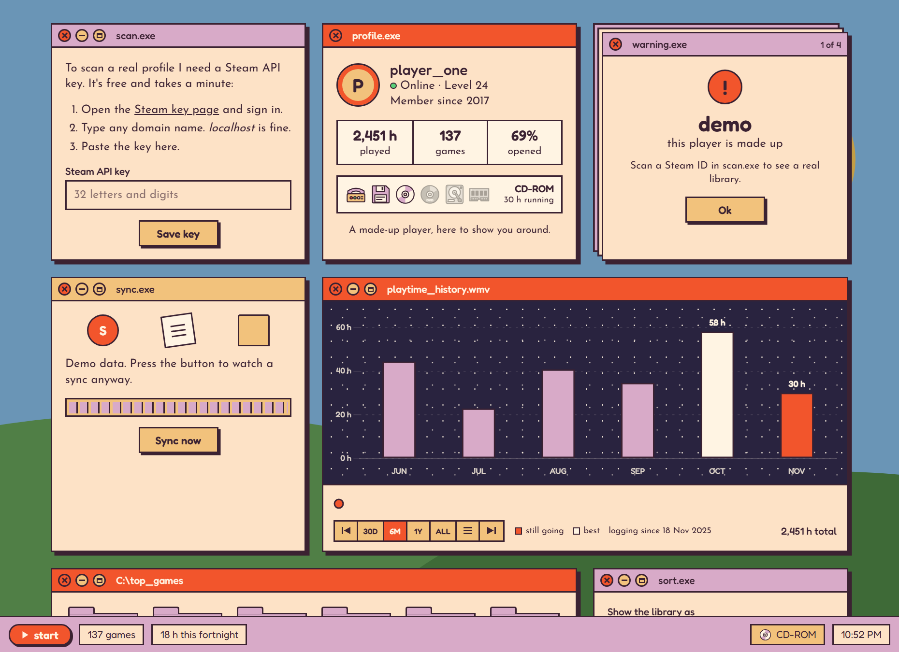

# Steam Stats Tracker

A small desktop app that reads a Steam library, remembers how it changes, and shows it all on a pretend retro desktop: every stat lives in its own little window you can drag around, minimise and close.



It opens in its own window (not a browser tab), works without an API key thanks to a built-in demo player, and keeps everything it learns in a local SQLite file.

## What it does

- **Scan a profile** by Steam ID, profile link or custom URL name. The progress bar is real: the server reports each step as it finishes.
- **Playtime history.** Steam only ever tells you lifetime totals, so the app logs the difference between scans and builds its own history from that.
- **Top games, recent games and the full library**, sortable and searchable.
- **warning.exe**: a stack of popups about your habits (how much of your library you never opened, that one game eating a third of your time).
- **achievements.exe**: how many achievements you've unlocked across your games, your latest unlocks, the games you've nearly finished, and your rarest unlock (with the share of all players who have it). If some played games haven't been checked yet, or Steam keeps a profile's achievements private, the window says so instead of pretending to be complete.
- **trophies.exe** (View all games in achievements.exe): every game with achievements in one big window, with average completion, perfect games and this year's unlocks at the top. Sort it by latest unlock, closest to perfect, most unlocked, perfect only, not started or A to Z, or search it. Click a game to see every one of its achievements: the unlocked ones with their date and rarity, and the ones still to get, the most common first.
- **Achievements over time** in the media player: unlocks per month for the last year, or per year since the very first one. Steam dates every unlock, so this chart goes back years, unlike the playtime history.
- **versus.exe**: compare with a friend, game by game, and on achievements in the games you both own.
- **wallpaper.exe**: pick a built-in wallpaper, or import your own pictures and dim them so the windows stay readable. Every picture you import stays in a little gallery until you delete it. It's under Start > Change wallpaper.
- **A working desktop**: drag windows, minimise them to the taskbar, maximise the chart, bring things back from the start menu.
- **Every scanned player in the start menu**, one click to switch. Done comparing with a friend? The red button next to their name forgets them: the app deletes their library, history and achievements, and their Steam account isn't touched.
- **Lives in the tray**, like Steam or Discord. Closing the window hides it next to the clock instead of quitting (the first time, Windows shows a short notice saying so). Click the icon to bring the window back; right-click it, or use Start > Shut down, to quit. Prefer the old way? Untick "Keep running in the tray" in Start > Settings.
- **Starts with Windows, if you want it to.** Tick "Start with Windows, in the tray" in Start > Settings and the app starts hidden next to the clock when you log in, so the hourly sync runs without you opening anything. It's off until you turn it on, and only the installed app offers it.
- **Badges for keeping it running**, a retro-tech ladder: Dial-up after 6 hours, then Floppy (12), CD-ROM (25), DVD (50), Hard drive (75) and RAM stick (150). The app counts the time it's open, in the window or in the tray, and time the computer spends asleep doesn't count. They show in profile.exe and next to the clock; click either for badges.exe and the whole ladder. A new one gets a popup (and a Windows notice if the app is in the tray).
- **Syncs by itself.** While the app is open, in the window or in the tray, it syncs every saved player about once an hour, so the playtime history fills in without you remembering to open it. Right-click the tray icon for Sync now. sync.exe says when the last background sync ran, and if it brought new numbers while you were looking, a "New data" button shows up in the taskbar. You can switch it off in Start > Settings.

[Full-page screenshot](docs/dashboard-full.png) · [trophies.exe](docs/trophies.png) · [badges.exe](docs/badges.png)

## Installing

Run `SteamStatsTracker-1.3.0-Setup.exe` (see [Building the installer](#building-the-installer) to make it). It installs just for you, so no admin password, and adds the app to the Start menu. You can also tick a desktop icon.

- Windows may show "Windows protected your PC" because the installer isn't code-signed. Click **More info**, then **Run anyway**.
- To update, run the newer installer. Your play history and API key stay. If the app is hidden in the tray, the installer asks you to quit it from the tray icon first.
- To remove it, use **Settings > Apps > Installed apps**. It asks whether to delete your saved data too, and takes the app off the programs Windows starts at login.

## Running it from source

You need Windows 10 or 11 and Python 3.10 or newer.

**The easy way:** double-click `run.bat`. The first run sets up a virtual environment and installs the dependencies, later runs just open the app.

**By hand:**

```bash
py -m venv .venv
.venv\Scripts\activate
py -m pip install -r requirements.txt
py desktop.py
```

`py app.py` runs the same thing in a normal browser at http://127.0.0.1:5000, which is handy while changing the CSS.

### Building the installer

You need [Inno Setup 6](https://jrsoftware.org/isinfo.php) (free) on top of the usual setup. Then double-click `build_exe.bat`. It takes under a minute and makes two things in `dist\`:

- `SteamStatsTracker\`: the app, built by PyInstaller from `packaging\SteamStatsTracker.spec`. It runs without Python.
- `SteamStatsTracker-<version>-Setup.exe` (for example `SteamStatsTracker-1.3.0-Setup.exe`): that folder packed into an installer by Inno Setup, from `packaging\installer.iss`. This is the file to share.

Without Inno Setup you still get the folder. A few things worth knowing:

- **The .exe needs its `_internal` folder.** That's where Python itself lives. Copy `SteamStatsTracker.exe` somewhere on its own and it stops with "Failed to load Python DLL". The installer exists so nobody has to know that.
- **Why a folder and not one big .exe.** A single-file build unpacks itself into a temp folder on every start. Measured here, it opened in 1.1 s against 0.7 s for the folder, and it leaves those temp folders behind if it's ever killed.
- **The version number** lives in `config.py` as `APP_VERSION`. The .exe's Properties tab, the About box and the installer's file name all read it from there.
- The installed app keeps its database, its `.env` and your wallpaper pictures in `%LOCALAPPDATA%\SteamStatsTracker`, not next to the program, which is why updates don't touch them.

## Using your own Steam data

The app starts with a made-up player so there's something to look at. To see a real library you need a free Steam Web API key:

1. Get one at https://steamcommunity.com/dev/apikey (any domain name works, `localhost` is fine).
2. Paste it into **scan.exe** inside the app. It checks the key with Steam and saves it to `.env`.

Or copy `.env.example` to `.env` and put the key there yourself. `.env` is in `.gitignore`, so the key never ends up on GitHub.

The profile you scan needs its **Game details** set to Public in Steam's privacy settings.

## How it's put together

```
desktop.py     opens the native window (pywebview) and runs Flask behind it
app.py         routes only
api.py         everything that talks to Steam, plus friendly error messages
sync.py        one scan: resolve the ID, fetch, save, then achievements and rarity
storage.py     SQLite: players, libraries and the play log
stats.py       totals, sorting, searching (pure functions)
charts.py      decides what each chart shows
captions.py    the jokes in the warning popups
demo.py        the made-up player
wallpaper.py   the wallpaper choice and the imported pictures
tray.py        the icon next to the clock, and what closing the window does
background.py  the hourly sync while the app is open
preferences.py the settings in settings.exe
startup.py     Start with Windows: one value in the registry's Run list
badges.py      the running clock and the badges it earns
config.py      every setting in one place
run.bat        sets things up on the first run, then opens the app
build_exe.bat  builds the app and its installer
packaging/     the PyInstaller and Inno Setup recipes build_exe.bat uses
templates/     one file per window, built from a shared window macro
static/css/    theme.css (all colours, fonts, sizes) and style.css (layout)
static/js/     window manager, scan progress, library, trophies, charts
tests/         307 tests; none can reach Steam or the real registry
```

A few decisions worth explaining:

- **History without a history API.** Each scan compares the new totals with the saved ones and writes only the differences to a `play_log` table. A normal day adds a handful of rows instead of one per game owned. In a test with 3,000 games and 400 days of play the log held about 2,100 rows and the database was 360 KB.
- **Saved data first, Steam second.** The dashboard is drawn from SQLite, so it opens straight away and works offline. If the data is older than 15 minutes the page asks for a fresh scan in the background.
- **Start with Windows is the registry, not a saved setting.** Ticking the box adds one value to `HKEY_CURRENT_USER\...\CurrentVersion\Run` (the list Windows starts at login), pointing at the .exe with `--tray`; unticking removes it. The box reads the registry every time, so it always shows what Windows will really do, including when the app was switched off in Task Manager's Startup tab. The tests use a pretend registry, so running them never changes what your PC starts.
- **Badges count time awake.** A clock thread adds the running time up once a minute, but a single tick never adds more than a minute, however long it really was since the last one. A laptop that slept all night wakes up to one late tick, so the night doesn't count. The total is one number in the database, and the badges are thresholds on it.
- **Scans take turns.** The hourly background sync and Sync now on the page run the same scan code. A lock makes the second one wait for the first, so they never save the same player at the same moment. A background sync also never reloads the page under you: the page compares a short stamp of its numbers (games, minutes, unlocks) with the server's once a minute and offers a button instead.
- **One connection to Steam.** A shared `requests.Session` keeps the connection open between calls. Measured here, the first call took about 600 ms and the following ones about 250 ms.
- **Achievements without hammering Steam.** Steam has no "all my achievements" call, only one per game. So a scan only asks about games you've actually played. After that it only asks again about games whose playtime went up, because achievements only unlock while you play: a normal scan is a handful of calls, not one per game. Steam flags the games that have achievements, and those go first, but the unflagged ones get asked too, because the flag isn't always right. It asks four games at a time. If Steam says "slow down", it waits a few seconds and carries on one game at a time, and only after a few tries does it leave the rest for the next scan. The first version gave up at the first "slow down", which left most of a real library unchecked. It also took Steam's "Profile is not public" as the last word, but Steam says that about some games even on a public profile, flagged ones included. Now a game like that just counts as checked with nothing to see, and only a player who never shared a single achievement counts as private. On a real profile that took the count from 11 games with achievements to 26. Rarity is fetched at most once a week per game, and icons only for the achievements on screen.
- **Sorting lives in Python only.** The page asks the server for re-sorted rows as HTML instead of repeating the sort rules in JavaScript.
- **An imported wallpaper is a copy.** The app checks the file's first bytes (not its name) to make sure it's really a PNG, JPG or WebP, then copies it into its data folder, so moving or deleting the original changes nothing. The copy is named after a fingerprint of its contents, so importing the same picture twice doesn't make a duplicate. The folder itself is the gallery: no list to keep in sync, and deleting a picture deletes its file. Pictures are sent to the window with `no-store`, so a deleted one doesn't linger in a cache either.
- **Names from Steam are untrusted.** Templates escape everything, a Content-Security-Policy blocks inline scripts, and the local server refuses requests that didn't come from its own window.
- **Errors are written for people.** Bad key, private profile, timeout, no connection: each one is its own exception with a title and message that go straight into a popup. The API key is kept out of error text on purpose.
- **One copy at a time.** On start the app claims a named Windows mutex. If a copy already holds it, the new one raises a named event (another flag Windows keeps by name) and quits, and the open copy shows its own window when it sees it. That way a second double-click brings the window back even when it's hidden in the tray, and you never get two windows writing to the same database. The installer checks the same name and asks you to close the app before it updates or removes it.

On my machine the dashboard for a 3,000-game library renders in about 25 ms, and saving a scan of that size takes about 14 ms.

## Making it yours

- **Colours, fonts, outline thickness, spacing:** `static/css/theme.css`. Nothing else contains a colour, and the charts read theirs from the same file.
- **Behaviour:** `config.py` (how many top games, cache time, chart ranges, alert thresholds, window size, version number, and for achievements: how many games to ask at once, what counts as "so close", how often rarity is refreshed, how long to wait when Steam says slow down, and how often the background sync runs).
- **The jokes:** `captions.py`.
- **The badges:** names and hours in `BADGES` in `config.py`, the drawings in `templates/partials/badge_art.html`, their colours (`--badge-*`) in `theme.css`. The line under each badge is in `captions.py`.
- **A new wallpaper pattern:** add a name to `WALLPAPER_PATTERNS` in `config.py` and a `.pattern--<name>` rule in `style.css`. It shows up in wallpaper.exe, preview included. A drawing (like the default, Hills) also gets its shapes in `templates/partials/wallpaper_art.html`.
- **The Hills colours, or how dim it is:** the `--hills-*` variables in `theme.css`. `--hills-dim: 0` shows it in full colour.
- **A new sort order:** add one function and one line to `SORT_ORDERS` in `stats.py`. The radio button appears on its own. The same goes for trophies.exe and `TROPHY_ORDERS`.
- **Window order:** reorder the `include` lines in `templates/dashboard.html`.

## Tests

```bash
py -m pip install -r requirements-dev.txt
py -m pytest
```

## Known limits

- History only starts when you first scan, and playtime is dated to the day of the scan that noticed it. Leave the app running in the tray and it scans every hour by itself, so the chart gets finer.
- The first scan of a big library takes a while longer, because achievements come one game per request. Later scans only ask about what you've played since.
- Windows only for now. pywebview supports macOS and Linux, but the `.bat` files, the installer and the console and single-copy code in `desktop.py` are Windows things.
- The installer and the .exe aren't code-signed (a certificate costs money every year), so Windows SmartScreen warns about them on other PCs.

## Credits

- Fonts: [Fredoka](https://fonts.google.com/specimen/Fredoka) and [Josefin Sans](https://fonts.google.com/specimen/Josefin+Sans), both under the SIL Open Font License (copies in `static/fonts`).
- Charts: [Chart.js](https://www.chartjs.org/) 4.6.1, MIT licence.
- Tray icon: [pystray](https://github.com/moses-palmer/pystray), LGPL-3.0, used unchanged as a library, and [Pillow](https://python-pillow.org/), MIT-CMU licence.
- Data: the [Steam Web API](https://developer.valvesoftware.com/wiki/Steam_Web_API). This project isn't affiliated with Valve.
